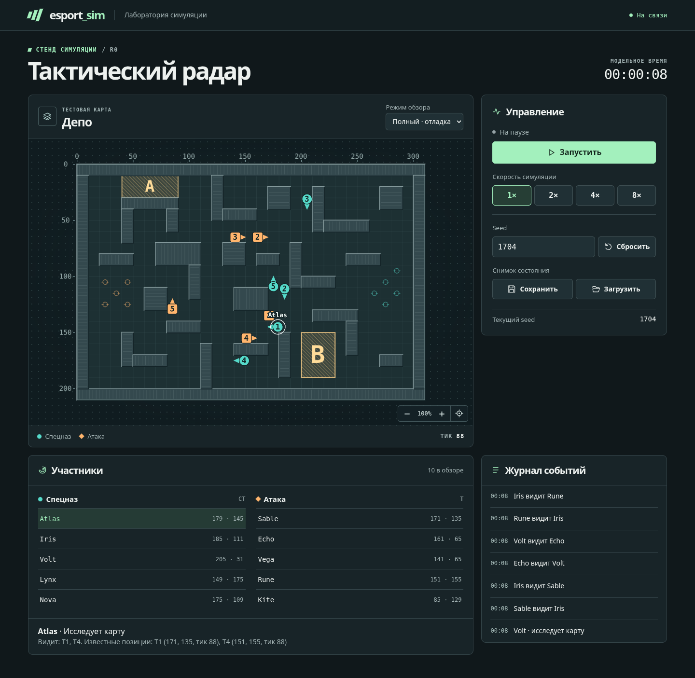

# esport_sim

Одиночный менеджер команды по Counter-Strike с автономной симуляцией матчей и матч-центром в стиле тактического радара HLTV.

Игрок — главный тренер-менеджер. Выше него только владелец организации. Менеджер отвечает за состав, персонал, подготовку, тактики и карьеру команды; во время раундов решения принимают сами киберспортсмены и капитан.

## Состояние проекта

На этапе R0 доступен стенд «Депо». Десять агентов исследуют оригинальную тестовую карту, обходят препятствия и запоминают увиденных соперников. На радаре можно выбрать агента, проверить его наблюдения, переключить обзор, запустить или приостановить расчёт. Ручной снимок и текущее состояние хранятся на домашнем ПК. Полный матч относится к R1.



## Запуск в Windows

Нужны Python 3.12, Node.js 24 с npm и Git. В PowerShell откройте каталог репозитория. Для первого запуска установите зависимости и соберите клиент.

```powershell
py -3.12 -m venv .venv
.\.venv\Scripts\python.exe -m pip install -r requirements.txt
npm.cmd ci --prefix frontend
npm.cmd run build --prefix frontend
.\.venv\Scripts\python.exe -m backend.run
```

Откройте <http://127.0.0.1:8765>. Последняя команда запускает и API, и собранный интерфейс. Для остановки нажмите Ctrl+C. При следующем запуске из того же каталога сервер откроет тот же файл `runtime-data/scenario.sqlite`. Нажмите «Запустить», выберите участника или переключите «Режим обзора». «Сохранить» записывает общий ручной снимок. «Загрузить» восстанавливает в том числе скорость, режим паузы, знания и состояние генераторов. «Сбросить» создаёт начальное состояние по введённому seed.

## Подключение телефона или планшета

В режиме по умолчанию игра доступна только на самом ПК. Для LAN подготовьте сертификат и закрытый ключ в формате PEM. Сертификат должен содержать DNS-имя или IP подключения в SAN, а его издатель должен быть доверенным на устройстве. Храните ключ вне репозитория. В примере замените адрес на локальный IPv4 своего ПК, укажите пути к файлам и разрешите входящие подключения на выбранном порту в профиле частной сети Windows. Остановите предыдущий экземпляр сервера перед сменой режима.

```powershell
.\.venv\Scripts\python.exe -m backend.run --mode lan --host 192.168.1.10 --port 8765 --origin https://192.168.1.10:8765 --cert C:\esport-certs\server.pem --key C:\esport-certs\server-key.pem
```

На телефоне откройте тот же HTTPS-адрес и введите одноразовый код из терминала. Он действует десять минут. Для подключения второго устройства выполните в другом окне PowerShell команду ниже. Она выпускает новый код и сохраняет действующие подключения.

```powershell
.\.venv\Scripts\python.exe -m backend.run --pair-new
.\.venv\Scripts\python.exe -m backend.run --list-devices
```

Список содержит идентификаторы сопряжённых устройств в порядке добавления. Чтобы отозвать одно подключение, передайте его идентификатор в `--revoke-device ID`. Команда `--revoke-all` завершает доступ всех сопряжённых клиентов. При нестандартном каталоге данных добавляйте одинаковый `--data` к командам запуска и управления.

Для удалённого доступа заранее установите защищённый маршрут до домашнего ПК, например через частную VPN. Выберите адрес интерфейса в этой сети. Имя в URL, сертификате и `--origin` должно совпадать. Команда для примера с адресом в VPN:

```powershell
.\.venv\Scripts\python.exe -m backend.run --mode remote --host 10.8.0.2 --origin https://10.8.0.2:8765 --cert C:\esport-certs\vpn.pem --key C:\esport-certs\vpn-key.pem
```

Поддерживается также сквозной TCP-туннель до TLS-порта сервера. В этом случае `--origin` задаёт видимый клиенту HTTPS-адрес с внешним портом. Раздавайте UI и API с одного origin. Доверие устройств работает через защищённую HttpOnly-cookie. При восстановлении WebSocket клиент получает полную текущую проекцию и сверяет команды с неопределённым результатом. Без соединения с сервером изменять мир нельзя. Сборка веб-клиента поддерживает параметр `VITE_SERVER_URL` для адреса API. Интеграция нативной оболочки Capacitor запланирована отдельно.

## Проверки

В PowerShell из корня репозитория. Добавление виртуального окружения в PATH даёт браузерным тестам доступ к тому же Python.

```powershell
$env:Path = (Resolve-Path .\.venv\Scripts).Path + ";" + $env:Path
python -m pip install -r requirements-test.txt
python -m pytest -q
python -m backend.headless --seed 42 --ticks 1200
Push-Location frontend
npm.cmd run build
npx.cmd playwright install chromium
npm.cmd test
Pop-Location
node frontend/e2e/mobile-tls.mjs
```

Сетевым тестам нужен исполняемый файл OpenSSL 3 в PATH. Его можно взять из установленного Git for Windows (каталог `usr\bin`). Для теста прямого подключения через выбранный сетевой интерфейс задайте `R0_TEST_LAN_IP` равным его локальному IPv4. Браузерные тесты запускают дополнительный сервер на порту 8766 и используют временную базу.

Скриншоты приёмки: [ПК](docs/screenshots/desktop.png), [смартфон вертикально](docs/screenshots/phone-portrait.png), [смартфон горизонтально](docs/screenshots/phone-landscape.png), [планшет вертикально](docs/screenshots/tablet-portrait.png), [планшет горизонтально](docs/screenshots/tablet-landscape.png). При повторном прогоне снимки находятся в `frontend/test-results/`.

## Основные требования

- Строго одиночная карьера. ПК, смартфоны и планшеты подключаются к домашнему серверу и используют одно состояние мира и общие сохранения.
- Полноценный адаптивный интерфейс с R0. На смартфонах и планшетах доступны все реализованные функции в портретной и альбомной ориентациях. Матч-центр и редактор тактик поддерживают сенсорное управление, включая жесты масштабирования и перемещения карты. Все действия доступны без наведения мыши.
- Реальные команды, игроки, персонал и турниры на выбранную дату базы; после начала карьеры мир развивается самостоятельно.
- Навыки игроков и персонала по шкале 0–100. Индивидуальный OVR, сила команды, VRS и статистические показатели матча — разные системы.
- VRS рассчитывается по закреплённой версии официальной модели Valve. Приглашения на турниры и Major определяются соответствующим регламентом.
- Полноценный скаутинг: знания менеджера отличаются от истинных характеристик в симуляции, оценки могут ошибаться и устаревать.
- Трансферы, контракты, экономика, тренировки, академия, персонал, отношения и обещания имеют последствия.
- FACEIT — обязательная внутриигровая среда поиска талантов и развития любительской сцены.
- Игроки самостоятельно разыгрывают матч. Счёт возникает из событий симуляции, а не выбирается заранее по рейтингу команд.
- Во время матча тренер даёт указания только в тактический тайм-аут; игроки сообщают свои наблюдения о соперниках и союзниках. Пользовательский лимит — три тайм-аута «за матч»; область лимита для серий и сопоставление с реальными правилами явно вынесены в [DECISIONS.md](DECISIONS.md).
- Тактики создаются на визуальной доске: маркеры, маршруты, направления, гранаты, ожидания и действия. От пользователя не требуется программирование.
- Обновления CS меняют маппул, баланс и другие параметры симуляции; частота выбирается в настройках игры.
- В мире существуют новости, интервью игроков и менеджеров, трансферные слухи, награды и история карьеры.
- Игра работает без LLM и API-ключей. Опциональная LLM может оформлять тексты, но не определяет игровые факты и результаты.
- Русскоязычный интерфейс. Каждый реализованный сценарий должен быть законченным и проверяемым; декоративные панели с выдуманными данными не считаются реализацией.

## Документация

| Документ | Что в нём |
|---|---|
| [AGENTS.md](AGENTS.md) | Обязательные правила работы Codex, границы изменений и критерии готовности |
| [GAME_DESIGN.md](GAME_DESIGN.md) | Игровые системы, полномочия менеджера и требования к миру |
| [MATCH_SIMULATION.md](MATCH_SIMULATION.md) | Матч, поведение игроков, тайм-ауты, обратная связь, радар и редактор тактик |
| [ARCHITECTURE.md](ARCHITECTURE.md) | Предлагаемая архитектура, данные, время, сохранения, контракты и проверки |
| [SOURCES.md](SOURCES.md) | Проверенные первоисточники Valve, версии и вопросы импорта реальных данных |
| [DECISIONS.md](DECISIONS.md) | Принятые ограничения, рабочие предложения и открытые решения |
| [ROADMAP.md](ROADMAP.md) | Последовательность разработки и критерии приёмки этапов |
| [CODEX_START.md](CODEX_START.md) | Готовая первая задача для Codex и порядок дальнейшей работы |

В спецификации различаются **согласованные требования**, **проектные предложения** и **вопросы, требующие решения**. Предложенные ранее численность мира, интервалы патчей и технические параметры не становятся автоматически утверждёнными константами.

## Техническая основа

На домашнем ПК работает сервер Python + FastAPI. Клиент использует React + TypeScript и PixiJS для карты и тактической доски. SQLite предназначена для сохранений, WebSocket передаёт обновления состояния. Симуляция отделена от HTTP, интерфейса и отрисовки.

Доступ по умолчанию ограничен домашним ПК. LAN и защищённое удалённое подключение включаются явно и требуют аутентификации подключаемого устройства. Сервер является единственным источником истины и разрешает конфликты одновременных команд. WebSocket восстанавливается автоматически. После переподключения клиент получает текущее состояние без потери применённого прогресса или повторного эффекта команды.

С R0 предусматривается упаковка того же frontend через Capacitor для Android и iOS на последующем этапе. Мобильному клиенту в браузере и в будущей оболочке нужен работающий домашний сервер. На ПК и через LAN игра доступна без интернета.

Версии библиотек зафиксированы в Python-списках зависимостей и npm lock-файле. Подробности устройства проекта приведены в [ARCHITECTURE.md](ARCHITECTURE.md). Следующий этап — полноценный автономный BO1. [ROADMAP.md](ROADMAP.md)

## Реальные данные и материалы

У каждого набора данных должны быть дата, происхождение и версия. Оценки способностей, неизвестные зарплаты и игровые черты характера нельзя выдавать за подтверждённые сведения о реальных людях. Новая реальная база используется при создании новой карьеры и не переписывает события существующего сохранения.

Исходная [MIT-лицензия проекта](LICENSE) сохранена. Внешние модели, базы, изображения, логотипы и карты учитываются отдельно по их собственным условиям; набор прав на них пока не исследован полностью.

## Измерение ядра R0

На Linux x86_64 (Intel Xeon Platinum 8573C, Python 3.12.14) запуск `python -m backend.headless --seed 42 --ticks 1200` рассчитал 120 модельных секунд за 0,457 с. Пик выделений Python по tracemalloc составил 153 123 байта. В замер входят создание сценария, поиск путей, движение, видимость и память десяти агентов. SQLite, сеть, GPU и интерфейс в этот замер не входят. SHA-256 итогового состояния: `e194b8187bfb7061090650561f0512a548acdc466599c38efe1448c9b2f7f6fa`.
