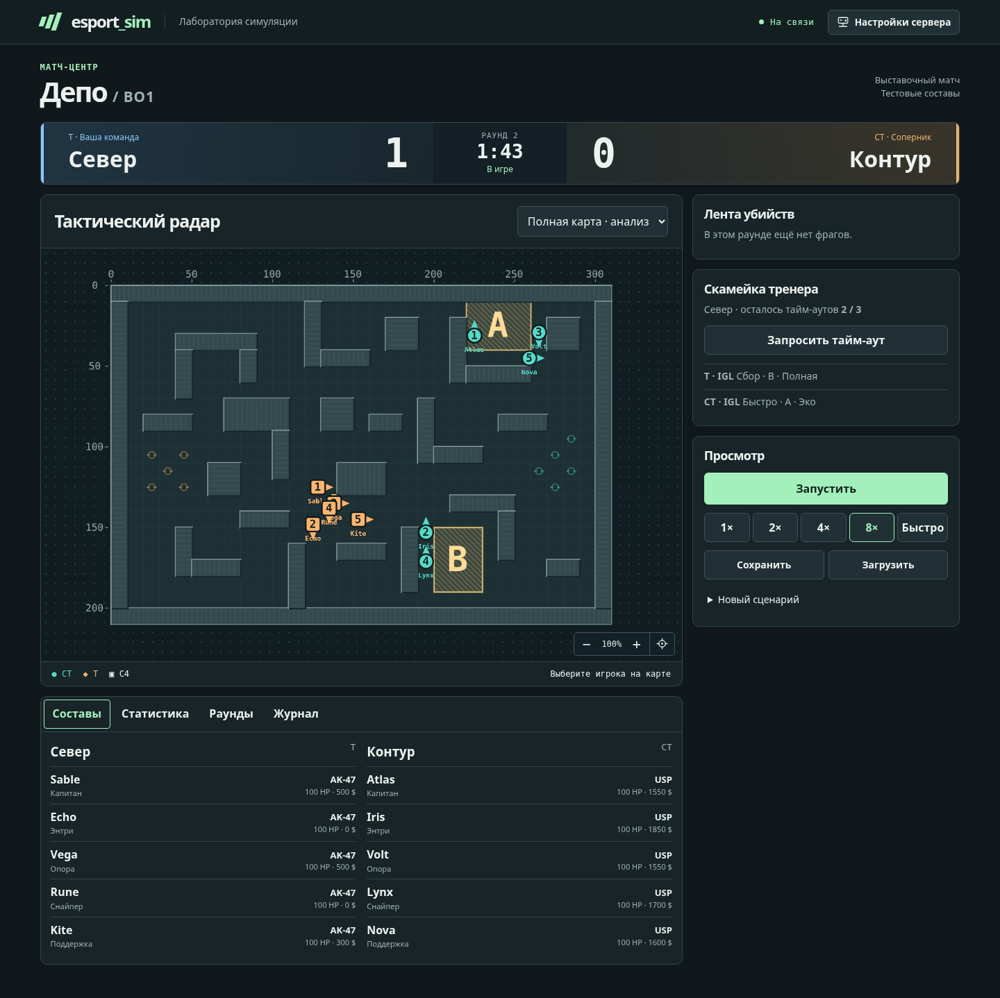

# esport_sim

Одиночный менеджер команды по Counter-Strike с автономной симуляцией матчей и матч-центром в стиле тактического радара HLTV.

Игрок — главный тренер-менеджер. Выше него только владелец организации. Менеджер отвечает за состав, персонал, подготовку, тактики и карьеру команды; во время раундов решения принимают сами киберспортсмены и капитан.

## Состояние проекта

**База сцены** открывает игровой профиль, связи, историю и предматчевый редактор. По умолчанию установлен ноябрьский пакет с 287 командами, 1 715 игроками и 32 тренерами. Локальный импорт студийных портретов запускается одной кнопкой в редакторе. В архиве также доступны 12 заявок на Остин. Воспроизводимый локальный импорт Valve даёт 277 названий команд и 1 582 записи игроков. Для выставочного матча выберите **База сцены → Подбор BO1**. [Пакеты, источники, редактирование и методика R3.2](docs/DATABASE_R32.md)

В R3.1 у спортсмена есть постоянный ID и 58 характеристик. Выставочный BO1 использует 53 из них. Ещё пять относятся к тренировкам и переговорам. В матч-центре выберите своего игрока в «Составах», чтобы увидеть рейтинги. Назначения характеристик, методика измерений и переход со старых сохранений описаны в [руководстве R3.1](docs/WORLD_R31.md).

На стартовом экране выберите **Открыть матч BO1 → Запустить**. Два тестовых состава играют выставочный матч на карте «Депо». На радаре видны движение, стрельба, гранаты и C4. Матч-центр показывает счёт, статистику, закупки и историю раундов. Вы тренируете «Север» и можете запросить три тактических тайм-аута. Сохранения R0 и стенд исследования карты доступны из того же приложения. [Правила BO1, управление и формулы статистики](docs/BO1.md)

В **Редакторе тактик** нарисуйте маршруты для пяти ролей, добавьте действия и запустите спарринг. Чтобы применить план, откройте BO1 и назначьте сохранённую версию до старта или в свой тайм-аут. [Работа с тактической доской](docs/TACTICS.md)



## Запуск в Windows

1. Откройте успешный запуск **Windows distribution** для нужной версии. В разделе **Artifacts** скачайте **EsportSim-windows-x64.zip**. Для скачивания артефакта GitHub Actions войдите в GitHub. [Сборки Windows](https://github.com/Troyevv/esport_sim/actions/workflows/windows-distribution.yml)
2. В Проводнике выберите **Извлечь всё**. Откройте папку `EsportSim` и дважды щёлкните **EsportSim.exe**. Держите файл рядом с каталогом `_internal`. ZIP содержит среду выполнения Python, сервер и собранный интерфейс.
3. Игра откроется в браузере по умолчанию. Для выставочного матча выберите **Открыть матч BO1 → Запустить**. Если закрыть вкладку, двойной щелчок по EXE вновь откроет текущую игру. Для полной остановки на домашнем ПК выберите **Настройки сервера → Остановить приложение → Подтвердить остановку**.

Дистрибутив предназначен для Windows x64. При первом запуске доступ ограничен домашним ПК. Обычно сервер открывается на порту 8765. Если порт занят, приложение само выбирает свободный порт и открывает правильный адрес.

### Где хранятся данные

Введите `%LOCALAPPDATA%\EsportSim` в адресной строке Проводника. Здесь находятся текущее состояние и ручной снимок (`scenario.sqlite`), настройки сетевого доступа, ключи локального УЦ и журнал запуска. Для обновления достаточно остановить приложение и распаковать новый ZIP в отдельную папку. **Сохранить** фиксирует ручной снимок, **Загрузить** возвращает к нему. При обычном закрытии и повторном запуске открывается последнее состояние.

Если вы пользовались предыдущим стендом из исходников, остановите его. До первого запуска можно поместить старую папку `runtime-data` рядом с `EsportSim.exe`. При пустом профиле приложение проверит и скопирует существующую базу вместе с зафиксированными изменениями SQLite. При запуске из исходников на Windows тот же перенос выполняется из `runtime-data` текущего каталога. Исходная база сохраняется. Для резервной копии закройте сервер перед копированием данных.

## Подключение телефона или планшета

1. Подключите телефон к той же частной сети, что и ПК. На ПК откройте **Настройки сервера**, выберите IPv4-адрес домашнего сетевого интерфейса и нажмите **Включить LAN**. Если Защитник Windows запросит доступ, разрешите его для частной сети. В окне появится HTTPS-адрес с портом 8767.
2. **Один раз установите доверие на телефоне.** ПК создаёт собственный удостоверяющий центр (УЦ) и сертификат для выбранного IP. Телефон не доверяет этому УЦ автоматически. Скачайте публичный файл `EsportSim-Home.cer` в настройках на ПК и передайте его на телефон по доверенному каналу, например через USB. Сверьте отпечаток SHA-256 с показанным на ПК. Закрытые ключи остаются в профиле Windows.
   - **iOS/iPadOS.** Откройте файл, установите загруженный профиль в настройках. В разделе **Основные → Об этом устройстве → Доверие сертификатам** включите полное доверие для этого УЦ.
   - **Android.** В настройках безопасности откройте установку сертификата **ЦС / CA** из файла. Названия разделов зависят от производителя. Для управляемого устройства, где личные УЦ запрещены, используйте согласованный с администратором сертификат и защищённый маршрут. При ошибке сертификата проверьте доверие и совпадение IP с адресом на ПК.
3. На ПК нажмите **Выдать код** и отсканируйте QR-код камерой телефона. Подтвердите сопряжение на телефоне. Также можно открыть показанный адрес и ввести одноразовый код вручную. Код действует десять минут и подходит одному устройству. Для следующего устройства выдайте новый код.
4. В списке **Разрешённые устройства** видны имена и активные соединения. **Отозвать доступ** отключает выбранное устройство. **Отключить LAN** закрывает сетевой порт и соединения, оставляя домашний интерфейс и текущую симуляцию доступными. После смены Wi‑Fi при необходимости выберите в настройках новый IP.

## Запуск из исходников для разработчиков

Для запуска из исходников на Windows установите Python 3.12 и Node.js 24 с npm. Распакуйте или клонируйте проект и дважды щёлкните **start.bat** в его корне. При первом запуске потребуется интернет для установки зависимостей. Скрипт создаст `.venv`, соберёт интерфейс и откроет игру в браузере после готовности сервера. Следующие запуски используют локальные зависимости и сборку. Изменение lock-файла обновляет соответствующие зависимости, изменение исходников интерфейса запускает новую сборку.

При первом запуске после обновления сохранения BO1 из ранних сборок PR #3 переносятся автоматически. Игра сохраняет исходные снимки и журналы в той же базе SQLite. Если журнал повреждён или версия сохранения неизвестна, подробности доступны в `%LOCALAPPDATA%\EsportSim\launcher.log`.

**stop.bat** в той же папке штатно останавливает экземпляр игры, открытый через BAT или EXE. Оба способа используют общий профиль `%LOCALAPPDATA%\EsportSim`. Если игра уже работает, повторный запуск открывает её в браузере. Чтобы применить изменения исходников к работающей игре, сначала откройте **stop.bat**, затем **start.bat**. В случае ошибки окно покажет причину и останется открытым.

Для ручного запуска из PowerShell откройте каталог репозитория.

```powershell
py -3.12 -m venv .venv
.\.venv\Scripts\python.exe -m pip install -r requirements.txt
npm.cmd ci --prefix frontend
npm.cmd run build --prefix frontend
.\.venv\Scripts\python.exe -m backend.run
```

Откройте <http://127.0.0.1:8765>. Для остановки CLI нажмите Ctrl+C. В Windows CLI по умолчанию использует профиль приложения, а в Linux — `runtime-data` текущего каталога. Флаг `--data` задаёт отдельный профиль.

### Сетевой запуск с собственным сертификатом

В режиме по умолчанию игра доступна только на самом ПК. Для LAN подготовьте сертификат и закрытый ключ в формате PEM. Сертификат должен содержать DNS-имя или IP подключения в SAN, а его издатель должен быть доверенным на устройстве. Храните ключ вне репозитория. В примере замените адрес на локальный IPv4 своего ПК, укажите пути к файлам и разрешите входящие подключения на выбранном порту в профиле частной сети Windows. Остановите предыдущий экземпляр сервера перед сменой режима.

```powershell
.\.venv\Scripts\python.exe -m backend.run --mode lan --host 192.168.1.10 --port 8765 --origin https://192.168.1.10:8765 --cert C:\esport-certs\server.pem --key C:\esport-certs\server-key.pem
```

На телефоне откройте тот же HTTPS-адрес и введите одноразовый код из терминала. Он действует десять минут. Для подключения второго устройства выполните в другом окне PowerShell команду ниже. Она выпускает новый код и сохраняет действующие подключения.

```powershell
.\.venv\Scripts\python.exe -m backend.run --pair-new
.\.venv\Scripts\python.exe -m backend.run --list-devices
```

Список содержит идентификаторы сопряжённых устройств в порядке добавления. Чтобы отозвать одно подключение, передайте его идентификатор в `--revoke-device ID`. Команда `--revoke-all` завершает доступ всех сопряжённых клиентов. При нестандартном каталоге данных добавляйте одинаковый `--data` к командам запуска и управления.

Для удалённого доступа заранее установите защищённый маршрут до домашнего ПК, например через частную VPN. Выберите адрес интерфейса в этой сети. Имя в URL, сертификате и `--origin` должно совпадать. Команда для примера с адресом в VPN:

```powershell
.\.venv\Scripts\python.exe -m backend.run --mode remote --host 10.8.0.2 --origin https://10.8.0.2:8765 --cert C:\esport-certs\vpn.pem --key C:\esport-certs\vpn-key.pem
```

Поддерживается также сквозной TCP-туннель до TLS-порта сервера. В этом случае `--origin` задаёт видимый клиенту HTTPS-адрес с внешним портом. Раздавайте UI и API с одного origin. Доверие устройств работает через защищённую HttpOnly-cookie. При восстановлении WebSocket клиент получает полную текущую проекцию и сверяет команды с неопределённым результатом. Без соединения с сервером изменять мир нельзя. Сборка веб-клиента поддерживает параметр `VITE_SERVER_URL` для адреса API. Интеграция нативной оболочки Capacitor запланирована отдельно.

### Сборка дистрибутива

Workflow **Windows distribution** собирает frontend с npm lock-файлом и упаковывает его вместе с интерпретатором и сервером с помощью PyInstaller. Для повторения на Windows x64 соберите frontend, установите в отдельное виртуальное окружение `requirements-package.txt` и запустите `python tools/package_windows.py` из корня. Готовый файл — `dist/EsportSim-windows-x64.zip`. Точные версии инструментов зафиксированы в [workflow](.github/workflows/windows-distribution.yml).

## Проверки

В PowerShell из корня репозитория. Добавление виртуального окружения в PATH даёт браузерным тестам доступ к тому же Python.

```powershell
$env:Path = (Resolve-Path .\.venv\Scripts).Path + ";" + $env:Path
python -m pip install -r requirements-test.txt
python -m pytest -q
python -m backend.headless --seed 42 --ticks 1200
Push-Location frontend
npm.cmd run build
npx.cmd playwright install chromium
npm.cmd test
Pop-Location
node frontend/e2e/mobile-tls.mjs
```

Сетевым тестам нужен исполняемый файл OpenSSL 3 в PATH. Его можно взять из установленного Git for Windows (каталог `usr\bin`). Для теста прямого подключения через выбранный сетевой интерфейс задайте `R0_TEST_LAN_IP` равным его локальному IPv4. Браузерные тесты запускают дополнительный сервер на порту 8766 и используют временную базу.

Скриншоты приёмки: [ПК](docs/screenshots/desktop.png), [смартфон вертикально](docs/screenshots/phone-portrait.png), [смартфон горизонтально](docs/screenshots/phone-landscape.png), [планшет вертикально](docs/screenshots/tablet-portrait.png), [планшет горизонтально](docs/screenshots/tablet-landscape.png). При повторном прогоне снимки находятся в `frontend/test-results/`.

## Основные требования

- Строго одиночная карьера. ПК, смартфоны и планшеты подключаются к домашнему серверу и используют одно состояние мира и общие сохранения.
- Полноценный адаптивный интерфейс с R0. На смартфонах и планшетах доступны все реализованные функции в портретной и альбомной ориентациях. Матч-центр и редактор тактик поддерживают сенсорное управление, включая жесты масштабирования и перемещения карты. Все действия доступны без наведения мыши.
- Реальные команды, игроки, персонал и турниры на выбранную дату базы; после начала карьеры мир развивается самостоятельно.
- Навыки игроков и персонала по шкале 0–100. Индивидуальный OVR, сила команды, VRS и статистические показатели матча — разные системы.
- VRS рассчитывается по закреплённой версии официальной модели Valve. Приглашения на турниры и Major определяются соответствующим регламентом.
- Полноценный скаутинг: знания менеджера отличаются от истинных характеристик в симуляции, оценки могут ошибаться и устаревать.
- Трансферы, контракты, экономика, тренировки, академия, персонал, отношения и обещания имеют последствия.
- FACEIT — обязательная внутриигровая среда поиска талантов и развития любительской сцены.
- Игроки самостоятельно разыгрывают матч. Счёт возникает из событий симуляции, а не выбирается заранее по рейтингу команд.
- Во время матча тренер даёт указания только в тактический тайм-аут; игроки сообщают свои наблюдения о соперниках и союзниках. Пользовательский лимит — три тайм-аута «за матч»; область лимита для серий и сопоставление с реальными правилами явно вынесены в [DECISIONS.md](DECISIONS.md).
- Тактики создаются на визуальной доске: маркеры, маршруты, направления, гранаты, ожидания и действия. От пользователя не требуется программирование.
- Обновления CS меняют маппул, баланс и другие параметры симуляции; частота выбирается в настройках игры.
- В мире существуют новости, интервью игроков и менеджеров, трансферные слухи, награды и история карьеры.
- Игра работает без LLM и API-ключей. Опциональная LLM может оформлять тексты, но не определяет игровые факты и результаты.
- Русскоязычный интерфейс. Каждый реализованный сценарий должен быть законченным и проверяемым; декоративные панели с выдуманными данными не считаются реализацией.

## Документация

| Документ | Что в нём |
|---|---|
| [AGENTS.md](AGENTS.md) | Обязательные правила работы Codex, границы изменений и критерии готовности |
| [GAME_DESIGN.md](GAME_DESIGN.md) | Игровые системы, полномочия менеджера и требования к миру |
| [MATCH_SIMULATION.md](MATCH_SIMULATION.md) | Матч, поведение игроков, тайм-ауты, обратная связь, радар и редактор тактик |
| [ARCHITECTURE.md](ARCHITECTURE.md) | Предлагаемая архитектура, данные, время, сохранения, контракты и проверки |
| [SOURCES.md](SOURCES.md) | Проверенные первоисточники Valve, версии и вопросы импорта реальных данных |
| [DECISIONS.md](DECISIONS.md) | Принятые ограничения, рабочие предложения и открытые решения |
| [ROADMAP.md](ROADMAP.md) | Последовательность разработки и критерии приёмки этапов |
| [CODEX_START.md](CODEX_START.md) | Готовая первая задача для Codex и порядок дальнейшей работы |

В спецификации различаются **согласованные требования**, **проектные предложения** и **вопросы, требующие решения**. Предложенные ранее численность мира, интервалы патчей и технические параметры не становятся автоматически утверждёнными константами.

## Техническая основа

На домашнем ПК работает сервер Python + FastAPI. Клиент использует React + TypeScript и PixiJS для карты и тактической доски. SQLite предназначена для сохранений, WebSocket передаёт обновления состояния. Симуляция отделена от HTTP, интерфейса и отрисовки.

Доступ по умолчанию ограничен домашним ПК. LAN и защищённое удалённое подключение включаются явно и требуют аутентификации подключаемого устройства. Сервер является единственным источником истины и разрешает конфликты одновременных команд. WebSocket восстанавливается автоматически. После переподключения клиент получает текущее состояние без потери применённого прогресса или повторного эффекта команды.

С R0 предусматривается упаковка того же frontend через Capacitor для Android и iOS на последующем этапе. Мобильному клиенту в браузере и в будущей оболочке нужен работающий домашний сервер. На ПК и через LAN игра доступна без интернета.

Версии библиотек зафиксированы в Python-списках зависимостей и npm lock-файле. Подробности устройства проекта приведены в [ARCHITECTURE.md](ARCHITECTURE.md). Правила матчевого профиля и границы этапов зафиксированы в дорожной карте. [ROADMAP.md](ROADMAP.md)

## Реальные данные и материалы

У каждого набора данных должны быть дата, происхождение и версия. Оценки способностей, неизвестные зарплаты и игровые черты характера нельзя выдавать за подтверждённые сведения о реальных людях. Новая реальная база используется при создании новой карьеры и не переписывает события существующего сохранения.

Исходная [MIT-лицензия проекта](LICENSE) сохранена. Внешние модели, базы, изображения, логотипы и карты учитываются отдельно по их собственным условиям; набор прав на них пока не исследован полностью.

## Проверка плавности радара

Сервер сохраняет шаг R0 в 100 мс. Радар обновляет положение и направление маркеров между подтверждёнными тиками с целью 60 кадров/с. При ускорении до 8× он использует промежуточные серверные позиции на поворотах. После паузы или восстановления соединения показ возобновляется с актуальной проекции.

После сборки интерфейса запустите `npx playwright test playback.spec.ts` из каталога `frontend` с активным Python-окружением. Тест замеряет интервалы между кадрами, в которых Pixi действительно обновил сцену, и время вызова отрисовки. В отчёте для каждой из пяти компоновок указаны FPS, медиана и 95-й процентиль интервала, 95-й процентиль длительности вызова и число промежуточных положений. Сенсорные профили используют плотность 2 пикселя на CSS-пиксель. Замер в эмуляции характеризует браузер и компьютер, на котором запущен тест.

Для диагностики рывков запустите `npx playwright test motion-diagnostics.spec.ts --project=desktop --project=phone-portrait`. Через настоящий WebSocket сервер передаёт позиции десяти агентов. Тест сравнивает обычную доставку с задержкой 215 мс у каждого двенадцатого пакета, сохраняя порядок сообщений. В `test-results` записываются интервалы прихода и показа, смещение за кадр, углы и длительность остановок. Отдельный прогон записывает десятисекундное видео игрового радара при 1× и 4×. В Windows CI запись доступна как артефакт `radar-motion.webm`.

## Измерение ядра R0

На Linux x86_64 (Intel Xeon Platinum 8573C, Python 3.12.14) запуск `python -m backend.headless --seed 42 --ticks 1200` рассчитал 120 модельных секунд за 0,457 с. Пик выделений Python по tracemalloc составил 153 123 байта. В замер входят создание сценария, поиск путей, движение, видимость и память десяти агентов. SQLite, сеть, GPU и интерфейс в этот замер не входят. SHA-256 итогового состояния: `e194b8187bfb7061090650561f0512a548acdc466599c38efe1448c9b2f7f6fa`.
