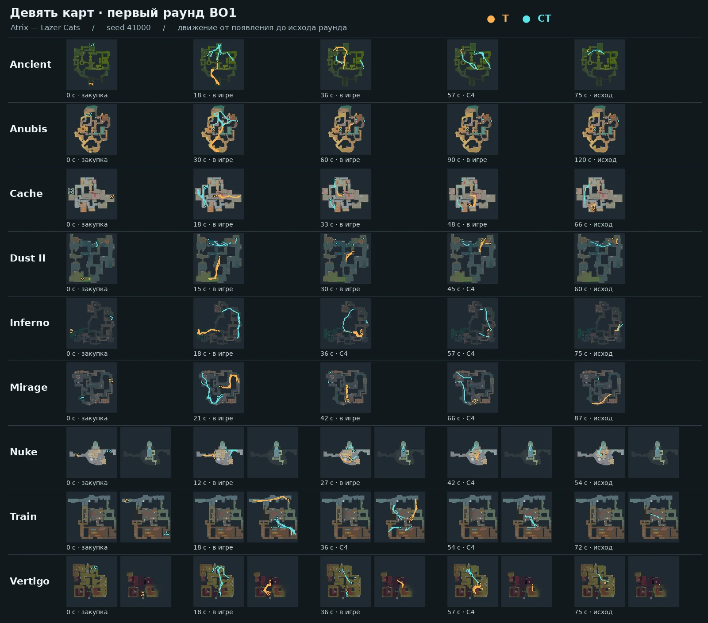

# Проверка карт R4.1

## Матчевые испытания на девяти картах

Серия на `942afc2` использует Steam BuildID 26879581 и пять игроков каждой команды из ноябрьской базы. На каждой карте сыграны 24 обычных BO1 с seed 41000–41023 и шесть парных повторов. В повторе сохранены составы, карта и seed, восемь характеристик игроков первой команды снижены на 20 с ограничением снизу нулём. Всего завершено 216 обычных BO1 и 54 контрольных. В обычной серии 24 пары составов сыграли 4 502 раунда, в 3 552 была установлена C4. Следующие две таблицы описывают эту серию. [Журналы, профили и повторы](https://github.com/Troyevv/esport_sim/actions/runs/45704225639)

| Карта | BO1 | Раунды T / CT (доля T) | Установки (доля раундов) | Разминирования от установок | Устранение / время / взрыв / разминирование | Попытки ретейка | Сейвы CT | Потери T от C4 | Медиана, с | Пик RSS, МиБ |
|---|---:|---:|---:|---:|---:|---:|---:|---:|---:|---:|
| [Ancient](https://github.com/Troyevv/esport_sim/actions/runs/45704225639/job/139522032395) | 24 | 288 / 193 (59.9%) | 444 (92.3%) | 35.8% | 286 / 0 / 36 / 159 | 444 | 53 | 0 | 8.19 | 284.3 |
| [Anubis](https://github.com/Troyevv/esport_sim/actions/runs/45704225639/job/139522032289) | 24 | 264 / 260 (50.4%) | 439 (83.8%) | 44.2% | 280 / 3 / 47 / 194 | 438 | 55 | 0 | 6.11 | 286.6 |
| [Cache](https://github.com/Troyevv/esport_sim/actions/runs/45704225639/job/139522032347) | 24 | 162 / 359 (31.1%) | 281 (53.9%) | 47.0% | 313 / 9 / 67 / 132 | 280 | 98 | 0 | 13.46 | 361.8 |
| [Dust II](https://github.com/Troyevv/esport_sim/actions/runs/45704225639/job/139522032285) | 24 | 356 / 124 (74.2%) | 379 (79.0%) | 19.3% | 254 / 2 / 151 / 73 | 375 | 270 | 0 | 5.79 | 238.2 |
| [Inferno](https://github.com/Troyevv/esport_sim/actions/runs/45704225639/job/139522032242) | 24 | 355 / 151 (70.2%) | 457 (90.3%) | 22.5% | 264 / 0 / 139 / 103 | 457 | 254 | 1 | 7.62 | 466.4 |
| [Mirage](https://github.com/Troyevv/esport_sim/actions/runs/45704225639/job/139522032308) | 24 | 220 / 242 (47.6%) | 375 (81.2%) | 47.7% | 236 / 4 / 43 / 179 | 373 | 57 | 0 | 6.55 | 229.6 |
| [Nuke](https://github.com/Troyevv/esport_sim/actions/runs/45704225639/job/139522032441) | 24 | 265 / 245 (52.0%) | 461 (90.4%) | 44.9% | 215 / 1 / 87 / 207 | 459 | 118 | 7 | 19.20 | 246.8 |
| [Train](https://github.com/Troyevv/esport_sim/actions/runs/45704225639/job/139522032461) | 24 | 481 / 81 (85.6%) | 409 (72.8%) | 9.3% | 363 / 1 / 160 / 38 | 408 | 297 | 0 | 9.28 | 352.6 |
| [Vertigo](https://github.com/Troyevv/esport_sim/actions/runs/45704225639/job/139522032435) | 24 | 173 / 283 (37.9%) | 307 (67.3%) | 47.9% | 300 / 4 / 5 / 147 | 307 | 11 | 0 | 4.95 | 225.8 |

Попытка ретейка означает раунд, в котором наблюдалась соответствующая задача хотя бы одного живого CT. Сейв учитывает выжившего защитника, принимавшего решение сохранить экипировку. Установка может завершиться устранением. Время измерено от создания матча до конца последнего раунда. Из медианы исключён прогон под cProfile. Пик RSS измерен для всего процесса Linux, включая нативную геометрию, кэши и запись повтора.

| Карта | Дым / свет / осколочные / огонь / ложные | Комбинации плент × стиль | Смены направления T | Размены | Проблемы пути | Раунды в парной проверке | Убийства в парной проверке |
|---|---:|---:|---:|---:|---:|---:|---:|
| Ancient | 483 / 865 / 632 / 624 / 18 | 8 | 31 | 837 | 0 | 52 / 58 | 431 / 390 |
| Anubis | 499 / 955 / 700 / 679 / 11 | 8 | 75 | 982 | 0 | 63 / 53 | 484 / 419 |
| Cache | 591 / 1387 / 1029 / 1019 / 0 | 8 | 190 | 599 | 0 | 57 / 25 | 390 / 254 |
| Dust II | 612 / 1197 / 874 / 882 / 19 | 8 | 97 | 713 | 0 | 63 / 60 | 399 / 391 |
| Inferno | 546 / 968 / 729 / 670 / 0 | 8 | 42 | 789 | 0 | 67 / 46 | 482 / 326 |
| Mirage | 529 / 1093 / 787 / 790 / 9 | 8 | 103 | 725 | 0 | 66 / 41 | 488 / 329 |
| Nuke | 589 / 1132 / 834 / 953 / 38 | 8 | 14 | 617 | 0 | 79 / 47 | 491 / 375 |
| Train | 561 / 1060 / 778 / 738 / 0 | 8 | 89 | 861 | 0 | 91 / 62 | 564 / 429 |
| Vertigo | 422 / 724 / 542 / 540 / 59 | 8 | 144 | 668 | 0 | 44 / 27 | 355 / 280 |

Проблема пути учитывается один раз для игрока за раунд, если наблюдались минимум 20 тиков неудачных попыток движения. Статусы снимались каждые десять тиков. В двух правых столбцах приведены суммы для первой команды в шести исходных BO1 и шести повторах после изменения характеристик. В 54 контрольных парах сумма выигранных первой командой раундов снизилась с 582 до 419, убийств — с 4 084 до 3 193. На Ancient первая команда выиграла на шесть раундов больше при меньшем числе убийств.

### Просмотр матчей и повторная проверка

Кадры записаны в первом обычном BO1 каждой карты, Atrix против Lazer Cats, seed 41000. Точки обозначают живых игроков, линии соединяют последовательные наблюдения. На Nuke, Train и Vertigo отдельно показаны этажи. Время отсчитывается от первого среза раунда. Полные записи событий и XYZ с шагом в одну игровую секунду доступны в артефактах `match-qa-*`. [Скачать повторы и профили](https://github.com/Troyevv/esport_sim/actions/runs/45704225639)

В первом раунде Ancient к установке остались двое атакующих против троих защитников. На Anubis после раннего контакта двое T и трое CT оставались живы до окончания времени. На Cache и Dust II атака довела раунд до установки в большинстве 4 против 2, хотя на Cache это произошло примерно на 18 игровых секунд позже. На Inferno в первом и пятом раундах атака вышла на разные стороны карты. На Mirage сдвиг защиты после установки хорошо виден на последовательных кадрах первого раунда.

На Nuke в первом раунде команды сошлись на верхнем уровне. В пятом участники переходили на нижний. За обычную серию на Nuke семь атакующих погибли от собственной C4, на Inferno один. На остальных картах эта причина гибели не встретилась. На Train в первом раунде T успели поставить C4 впятером. Через 15 игровых секунд вся атака выбыла, четверо CT ещё были живы. За 24 матча атака выиграла 481 из 562 раундов, самый большой перевес сторон в этой серии. На Vertigo игроки в первом раунде прошли через разные высотные секции. После установки четырьмя T против двух CT к концу раунда выжили два атакующих.

При повторной проверке защитники распределяли позиции между союзниками, реагировали на сообщения капитана и искали за укрытиями установленную C4. Прикрывший разминирование игрок теперь проверяет доступность укрытия до начала перехода. Когда единственный проход закрывает видимая огненная граната, игрок дожидается её окончания. В таблице ниже приведены наблюдавшиеся эпизоды минимум из 20 последовательных неудачных попыток движения и самые частые задачи в таких эпизодах.

| Карта | Эпизоды игрок × раунд | Самая долгая серия неудачных шагов¹, с | Две наиболее частые задачи |
|---|---:|---:|---|
| Ancient | 0 | 0.0 | — |
| Anubis | 0 | 0.4 | — |
| Cache | 0 | 0.0 | — |
| Dust II | 0 | 0.5 | — |
| Inferno | 0 | 0.0 | — |
| Mirage | 0 | 0.0 | — |
| Nuke | 0 | 0.8 | — |
| Train | 0 | 0.5 | — |
| Vertigo | 0 | 0.6 | — |

¹ В 4 502 обычных раундах не зарегистрировано эпизодов от двух секунд. Состояние игрока снималось по окончании каждого десятого тика. Ожидание у видимого огня и удержание назначенной позиции учитываются отдельно от ошибки пути.

Во всех девяти заданиях суммарное время 207 матчей без профилировщика составило 1 914 с. Это около 389 BO1 на час суммарного времени расчёта при загрузке одной карты на процесс. Карьерный замер ниже отдельно учитывает чередование карт. В профиле Nuke самый дорогой участок — поиск физического пути `_path` (13,11 с собственного времени). На Anubis трассировка `_trace` заняла 2,04 с собственного времени. Профили `.prof` сохранены в артефактах каждой карты.

### Карьера и дистрибутив

Для сравнения карьерный тест берёт одну встречу из календаря и последовательно назначает ей каждую из девяти карт при неизменных составах и seed. Для каждой карты проверены полное фоновое исполнение, повтор после сохранения и загрузки состояния на 80-м тике и равенство записанного в SQLite отчёта. Время создания матча и расчёта полного фонового BO1 измерены отдельно. RSS относится ко всему процессу сразу после BO1 и включает удерживаемые данные предыдущей карты.

| Карта | Создание матча, с | Фоновый BO1, с | RSS после BO1, МиБ |
|---|---:|---:|---:|
| de_ancient | 0.37 | 9.01 | 371.6 |
| de_anubis | 0.45 | 12.27 | 484.4 |
| de_cache | 0.42 | 32.05 | 560.0 |
| de_dust2 | 0.50 | 12.74 | 527.4 |
| de_inferno | 0.56 | 17.37 | 639.1 |
| de_mirage | 0.48 | 14.48 | 634.6 |
| de_nuke | 0.60 | 40.71 | 374.4 |
| de_train | 0.53 | 19.09 | 541.0 |
| de_vertigo | 0.37 | 13.23 | 522.1 |

В интеграционном прогоне проверены запуск выставочных матчей, редактор и предпросмотр тактик, сохранения и восстановление. Playwright открывает каждую карту в матч-центре и на тактической доске с настольным и мобильным размером окна. [Журнал и снимки экранов](https://github.com/Troyevv/esport_sim/actions/runs/45704225639/job/139522031449)

Windows ZIP включает EXE и ресурсы девяти карт. Проверены запуск на чистом Server Core без установленных Python и Node.js, карьера, загрузка Nuke из сохранения и открытие приложения в системном браузере. [Windows ZIP](https://github.com/Troyevv/esport_sim/actions/runs/45704225530/artifacts/15065150674) · [Приёмка Windows](https://github.com/Troyevv/esport_sim/actions/runs/45704225530) · [Регрессия предыдущих этапов](https://github.com/Troyevv/esport_sim/actions/runs/45704225702)

На `942afc2` локально прошли 222 теста Python. Десять тестов, требующих установленного комплекта, отдельно прошли в CI, как и оба сценария настольного и мобильного обзора реальных карт. В общей браузерной регрессии прошли 96 сценариев, семь пропущены по условиям тестов. Контрольный BO1 на Депо с seed 42 снова дал 13–16, 15 670 тиков, 5 360 событий и SHA-256 `610ac9bd53583ed50006205b7f09673bf18cfef249b3890600ffe4e5e4de3a6f`.

### Наблюдения по предшествующей серии `4b7affa`

На радаре просмотрены матчи seed 41000 на всех девяти картах, включая смену сторон. Начальная позиция, переходы, остановки и позиции выживших восстановлены из координат десяти игроков. Журнал содержит срезы каждые три игровые секунды. Файлы `*-frames.json` и `*-events.json` в артефактах каждой карты содержат более частые срезы и события.

На Ancient атака в соседних раундах шла через разные половины карты. На Anubis и Dust II защита неоднократно подходила к пленту уже после входа атакующих. Защита выиграла 70 из 592 и 70 из 547 раундов соответственно. На Inferno видны и разделение атаки между подходами, и повторные заходы с одной стороны. На Mirage защита возвращалась с исходных точек и выполнила 206 разминирований за серию. На Cache обе стороны подолгу оставались в разных частях карты. Там 85 раундов завершились по времени. На Train повторялись ранние установки и поздние смещения защиты. На Nuke переходы между уровнями требуют отдельной подложки, а в серии произошли 16 смертей T от собственной C4.

На Vertigo до учёта состояния `func_brush` один матч дал 57 тайм-аутов за 60 раундов. После исправления импорта, проверки ширины порталов и поиска физически проходимых маршрутов в 24 обычных матчах получено 32 тайм-аута за 500 раундов. Эпизоды недоступного пути ещё наблюдались на каждой карте. [Исходная диагностика препятствий](https://github.com/Troyevv/esport_sim/actions/runs/45694433098) · [Повторный импорт и проверка коллизий](https://github.com/Troyevv/esport_sim/actions/runs/45695286713)

Профиль Anubis выделил обход дерева аналитических примитивов при проверке видимости. В серии `4b7affa` до 5,75 с собственного времени профилированного матча ушло на обход кандидатов. На Nuke заметен поиск физически допустимого пути. В интеграционных тестах на всех картах проверены сохранения, редактор, предпросмотр и воспроизводимость карьерного отчёта после загрузки. [10 интеграционных тестов](https://github.com/Troyevv/esport_sim/actions/runs/45696554020/job/139495500802)

### Исправления по повторным сериям

На `ce7b757` у защитников Vertigo зарегистрированы 64 эпизода недоступного пути при прикрытии разминирования, на Mirage — 65. Проверка координат показала, что все 47 записанных примеров на Vertigo относились к одной высотной секции радара для исходной и целевой точек. В 46 случаях целью был полигон 1045, недоступный от исходного по обычным направленным рёбрам NAV. Игрок брал элемент из общего списка укрытий без проверки перехода с текущей позиции. На `9bd6194` после выбора достижимого укрытия ни на одной из этих карт такой эпизод не встретился за 24 обычных BO1. В новой серии остались случаи блокировки при попытке поддержки перейти в точную позицию капитана. Точка встречи перенесена на доступную поверхность в пределах дистанции размена. [Диагностика задач игроков](https://github.com/Troyevv/esport_sim/actions/runs/45701081789) · [Повтор на девяти картах](https://github.com/Troyevv/esport_sim/actions/runs/45702191818)

В серии `9bd6194` на Ancient CT обезвредили 365 из 440 установленных бомб. При проверке поведения обнаружилось, что атакующий мог держать закрытый угол после установки, а начало разминирования не создавало локального звукового наблюдения. Добавлены проверка видимости C4 с выбранного укрытия и реакция на слышимый звук начала действия. Игроку не передаются личность соперника, наличие набора или информация о прекращении действия. На Anubis медиана полного матча составила 6,94 с после уточнения пересечений с деревом аналитических примитивов. В серии `4b7affa` она составляла 13,80 с. [Результаты, покадровые повторы и cProfile](https://github.com/Troyevv/esport_sim/actions/runs/45702191818)

## Исходный импорт и проверка NAV

Срез базы от 24 ноября 2026 года, Steam BuildID 26879581, ClientVersion 2000950. Измерения выполнены на исходных VPK всех девяти карт. Каждая из 273 включённых точек появления лежит на полигоне NAV и имеет направленный маршрут до поверхности внутри каждого из двух объёмов установки. [Полный журнал измерений](https://github.com/Troyevv/esport_sim/actions/runs/45678135148)

| Карта | Спавны T/CT | Полигоны NAV | Полигоны внутри A/B¹ | Укрытия NAV | Лестницы NAV | Треугольники физики² | Неразрешённые модели² | Лучи между уровнями³ |
|---|---:|---:|---:|---:|---:|---:|---:|---:|
| de_ancient | 12/12 | 1969 | 11/25 | 262 | 0 | 969064 | 0 | 0/0 |
| de_anubis | 16/16 | 2633 | 50/34 | 378 | 0 | 699346 | 0 | 10/10 |
| de_cache | 16/16 | 2209 | 19/62 | 288 | 1 | 1632487 | 0 | 60/63 |
| de_dust2 | 15/15 | 2242 | 14/47 | 207 | 0 | 435685 | 0 | 18/18 |
| de_inferno | 16/16 | 2739 | 63/71 | 381 | 0 | 2774385 | 0 | 28/29 |
| de_mirage | 17/16 | 2544 | 27/22 | 372 | 2 | 140391 | 0 | 19/19 |
| de_nuke | 16/16 | 3040 | 43/39 | 477 | 6 | 193360 | 0 | 810/816 |
| de_train | 14/14 | 2154 | 29/49 | 313 | 11 | 1595844 | 0 | 36/36 |
| de_vertigo | 15/15 | 2105 | 23/9 | 309 | 1 | 216678 | 0 | 336/337 |

1. В выборку попадает полигон, если центр его поверхности с поправкой в одну единицу Hammer по высоте находится внутри исходного трёхмерного объёма установки. Области, лишь частично пересекающие плент, могут не попасть в эту выборку.
2. Экспорт выполнен с общими моделями из того же манифеста Steam. В прогоне с одними VPK карт на Inferno отсутствовали 89 ссылок. После загрузки общих пакетов экспортёр разрешил все ссылки на девяти картах. Помимо треугольников в данных есть сферы и капсулы — 52 примитива на Anubis, 1 на Dust II и 37 на Inferno. [Первый прогон](https://github.com/Troyevv/esport_sim/actions/runs/45676900926) · [Прогон с общими моделями](https://github.com/Troyevv/esport_sim/actions/runs/45678135148)
3. Числитель показывает число перекрытых лучей, знаменатель — число проверенных пар поверхностей в одинаковых XY на разных высотах. Проверка использует статическую сетку Awpy. Для Inferno её пришлось построить из физической модели карты, поскольку в датированном релизе эта сетка отсутствует. На Ancient подходящих пар в выборке не оказалось. Координаты и исходная физика открытых лучей приведены ниже.

## Открытые лучи статической сетки

Из 1 328 проверенных пар поверхностей 11 дали открытый луч в сетке Awpy. По тем же отрезкам между точками на 64 единицы выше NAV проверены исходные коллизии. В таблице XY и высоты пересечений округлены до десятых единицы Hammer. Полная точность, границы луча, хеш материала и группа каждой грани сохранены в журнале. [Исходные пересечения](https://github.com/Troyevv/esport_sim/actions/runs/45680868365/job/139440729540)

| Карта | Нижняя → верхняя область | X | Y | Что пересекает луч |
|---|---|---:|---:|---|
| Cache | 439 → 708 | 513 | 743 | `playerclip` на Z 1710 и 1754,6 |
| Cache | 766 → 1082 | 952,5 | 687 | `playerclip`, две грани `Default/metal` на Z 1793 и 1831, ещё две грани `Default` на 1838,2 и 1843,2 |
| Cache | 833 → 1082 | 952,5 | 742 | `playerclip` и две грани `Default` на Z 1856,1 и 1861,5 |
| Inferno | 108 → 149 | −287,5 | −213 | `playerclip` на Z 209,5 и 223 |
| Nuke | 486 → 399 | −379,9 | −765,6 | `playerclip` на Z −306 и −155 |
| Nuke | 1240 → 1269 | 1329 | −400 | Решётка `passbullets/metalgrate`, Z −134 и −128 |
| Nuke | 1241 → 1234 | 1282,5 | −533,5 | Та же решётка, Z −134 и −128 |
| Nuke | 1367 → 1328 | 1319 | −518 | Та же решётка, Z −134 и −128 |
| Nuke | 1383 → 1344 | 1323 | −514 | Та же решётка, Z −134 и −128 |
| Nuke | 1557 → 1432 | 1409,5 | −509 | `playerclip` на Z −306 и −223 |
| Vertigo | 1144 → 1555 | −2075 | −1056,5 | `playerclip` на Z 11718,9 |

Пять лучей пересекают только объёмы ограничения перемещения, четыре — решётку. Это согласуется с фильтром сетки видимости, который удаляет `playerclip` и `passbullets`. Для двух лучей Cache экспортёр также нашёл обычные грани мира. У части граней этой пары имя материала не расшифровано (`vrf_unknown_key_1082159296`). [Правила построения сетки Awpy](https://github.com/pnxenopoulos/awpy-data/blob/7c73907f74521d271f0eb40bcbe14a4912184e05/scripts/process_geometry.py)

На Cache контрольная сетка из `world_physics.glb` без упрощения содержит 1 263 911 треугольников. Она перекрывает 62 из 63 лучей. Для пар 766 → 1082 и 833 → 1082 восстановлено перекрытие, пара 439 → 708 остаётся открытой. Это две потери перекрытия в сетке релиза. Для этих участков следует использовать сетку из VPK без упрощения. В CI закреплены оба перекрытия и открытый контрольный луч. [Сравнение по тем же координатам](https://github.com/Troyevv/esport_sim/actions/runs/45681863931/job/139444201215)

## Тактические маршруты

В каждом профиле есть по два выхода атаки на A и B, четыре позиции защиты и центральная позиция для обеих сторон. Для каждой активной точки появления проверяется путь по направленным рёбрам и лестницам. Выход атаки должен пройти через именованные зоны в порядке профиля и закончиться на поверхности внутри нужного плента. Если у зоны несколько полигонов, планировщик учитывает стоимость оставшегося пути при выборе каждого перехода.

Первый прогон выявил четыре недоступных маршрута из 90. На Cache метки `Middle` соответствовали верхним полигонам 708 и 1082. Это нарушало выход на B и подход к центру с обеих сторон. На Dust II метка `TopofMid` попала на полигон 90 на объекте рядом с проходом. До него не было пути ни от одного из 15 спавнов T. [Журнал до исправления](https://github.com/Troyevv/esport_sim/actions/runs/45679930259)

После сверки радара, высот и направлений NAV для `Middle` на Cache выбраны полигоны 439 и 688 под верхними поверхностями. Для `Checkers` выбран 2198 внутри комнаты, поскольку прежняя выборка допускала один и тот же полигон 390 для вентиляции и следующей позиции. На Dust II полигон 70 лежит на полу рядом с объектом. Привязки закреплены по SHA-256 NAV. Для остальных меток журнал указывает расстояние от объекта `env_cs_place` до выбранной поверхности или ближайшего центра полигона. Исполнение этих путей в матчах рассмотрено в разделах о BO1.

После исправления доступны все 90 маршрутов на девяти картах. Все 1 365 сочетаний «спавн своей стороны — маршрут профиля» имеют направленный путь. В журнале для каждого варианта указаны исходный полигон, промежуточные полигоны и число переходов восстановленного маршрута. [Прогон после исправления](https://github.com/Troyevv/esport_sim/actions/runs/45680868365)

## Аудит матчевого ядра до интеграции

В `backend/match.py` покупка, смена сторон и завершение раунда принадлежат общему ядру. Расстановка игроков и проверка игровых целей зависят от геометрии Депо. В `backend/match_ai.py` решения об удержании, ротации, выходе и выборе укрытия опираются на фиксированные позиции и маршруты. В `backend/tactics.py` валидация пользовательской тактики привязана к одной карте. Для нового формата карты реализованы XYZ-навигация и проверка исходного объёма установки. Состояние до интеграции зафиксировано здесь для сравнения с сериями BO1.

## Проверка автономных матчей

Контроль старого сценария выполнен командой `python -m backend.headless --bo1 --seed 42` на коммитах `e619bd1` и `79feb82`. На Депо оба прогона дали счёт 13–16, 15 670 тиков, 5 360 событий и одинаковый SHA-256 итогового состояния `610ac9bd53583ed50006205b7f09673bf18cfef249b3890600ffe4e5e4de3a6f`.

### Первые 108 BO1

Коммит `c7403c4`, Steam BuildID 26879581. На каждой карте сыграны 12 матчей до условия победы общего ядра. Для seed 41000–41011 выбраны по две пятёрки из ноябрьской базы. Время включает инициализацию матча. Медиана рассчитана без одного прогона под cProfile на карту. Память в этой серии измерялась по RSS процесса каждые 200 тиков. [Журналы серии и полные повторы](https://github.com/Troyevv/esport_sim/actions/runs/45690677907)

| Карта | BO1 | Раунды T / CT | Установки | Устранение / время / взрыв / дефьюз | Попытки ретейка¹ | Сейвы² | Гибель T от C4 | Гранаты | Медиана, с | Наибольший замер, МиБ |
|---|---:|---:|---:|---:|---:|---:|---:|---:|---:|---:|
| de_ancient | 12 | 215 / 65 | 239 | 96 / 2 / 131 / 51 | 233 | 313 | 0 | 1122 | 3.62 | 220.2 |
| de_anubis | 12 | 125 / 141 | 210 | 51 / 25 / 95 / 95 | 207 | 107 | 0 | 1513 | 4.52 | 220.0 |
| de_cache | 12 | 162 / 82 | 173 | 106 / 30 / 74 / 34 | 171 | 46 | 0 | 2660 | 8.46 | 290.3 |
| de_dust2 | 12 | 206 / 63 | 212 | 83 / 9 / 148 / 29 | 211 | 60 | 0 | 2477 | 3.77 | 172.1 |
| de_inferno | 12 | 159 / 116 | 229 | 115 / 10 / 73 / 77 | 227 | 72 | 0 | 1931 | 18.39 | 382.1 |
| de_mirage | 12 | 178 / 96 | 197 | 81 / 33 / 127 / 33 | 192 | 116 | 0 | 2466 | 4.67 | 142.6 |
| de_nuke | 12 | 179 / 76 | 244 | 131 / 11 / 48 / 65 | 236 | 63 | 0 | 2015 | 8.04 | 151.3 |
| de_train | 12 | 237 / 44 | 231 | 109 / 19 / 148 / 5 | 217 | 420 | 0 | 2223 | 4.63 | 289.6 |
| de_vertigo | 12 | 133 / 113 | 172 | 137 / 13 / 47 / 49 | 168 | 55 | 0 | 1798 | 5.68 | 141.7 |

¹ Раунды, когда хотя бы один живой защитник получил задачу ретейка. ² Выжившие защитники, для которых наблюдалось решение сохранить оружие. Оба статуса снимались каждые десять тиков.

На Train защита обезвредила бомбу пять раз за 281 раунд. При просмотре траекторий повторялись случаи, когда два защитника одного плента заканчивали начальный переход в одной точке. При выборе одной из двух именованных позиций использовался остаток от деления номера слота на два. Для обоих защитников плента он совпадал. Исправлены выбор позиции и поиск второго плента после публичного сигнала установки. Проверки видимости составляли крупнейшую статью процессорного времени на большинстве карт. Пакетная трассировка и учёт коллизий при движении внесены после этой серии. Счётчик препятствий в первой серии не измерял навигационные сбои.
