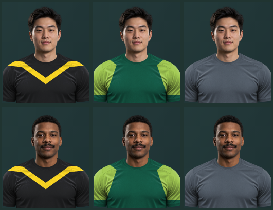

# Динамические портреты

Профиль игрока, список базы, связанные карточки, состав и матч-центр используют один компонент. Игровая внешность — RGBA PNG на прозрачном холсте 240×280 или 480×560. На нём только волосы, голова, уши и шея. Отдельный слой трикотажа даёт плечи и верх торса. Основной цвет и отделка сохраняют фактуру, швы, тени и объём ткани. Эмблема команды накладывается на грудь поверх материала. Исходная фотография и атрибуция сохраняются отдельно.

Откройте **База сцены → игрок → Примерочная формы**. Выберите клуб или «Свободный агент». Здесь можно сравнить комплекты для одной внешности. В основной карточке комплект определяется последней датированной заявкой выбранной редакции. При одинаково свежих заявках за разные команды используется нейтральная одежда. В BO1 используется клуб выбранной на матч пятёрки. Официально отмеченный свободный агент в базе получает нейтральный комплект. Цвета и рисунок — игровой дизайн, источник эмблемы указан отдельно. В редакторе команды можно задать основной цвет, отделку и рисунок. Старая редакция пакета и уже начатый матч сохраняют прежний комплект.

## Пилотная примерка

Слева направо — игровые комплекты Vitality и Astralis, затем нейтральная одежда. В обоих рядах использованы синтетические лица тестовых персонажей. Они находятся в тестовых данных и не назначены реальным спортсменам. Экран снят с работающей примерочной. Автотест меняет клуб сначала в примерочной, затем переносит одного персонажа в другую заявку, перечитывает сохранённую редакцию и сравнивает содержимое слоя головы.

В базовой поставке готовых голов реальных спортсменов пока нет. Сцены награждения, интервью и отвергнутый пользователем ростовой кадр donk исключены из игровых портретов. Пилотные внешности на иллюстрации получены локальным автоматическим обработчиком из двух тестовых студийных изображений. Там, где подготовленного слоя пока нет, показывается нейтральный силуэт. Исходные снимки тренеров доступны в профилях штаба.

## Необязательная ручная подготовка слоя

1. Возьмите оригинал с лицензией, допускающей производные работы. Зафиксируйте автора, ссылку, лицензию, описание обработки и SHA-256 файла. Предпочтителен почти фронтальный кадр с видимыми волосами и шеей.
2. На копии известной ширины обведите волосы, уши и шею по границе одежды. Запишите координаты в исходном порядке. Отметьте центры глаз. Слишком сильный поворот, перекрытие микрофоном или обрезанная макушка требуют другого исходника.
3. Выполните `python -m tools.prepare_portrait original.jpg recipe.json head.png` из окружения игры. Поля JSON: `sha256`, `referenceWidth`, `eyes` (две пары координат), `contour` (массив точек замкнутого контура), необязательные `eyeSpan` и `eyeY` в координатах базового холста. Инструмент учитывает EXIF, выравнивает линию глаз и сохраняет исходные черты. Контур определяет отдельный альфа-канал.
4. Загрузите PNG в редакторе игрока через **Слой головы и шеи**. Укажите автора, страницу источника, лицензию и внесённые изменения. Проверьте волосы и уши на светлом и тёмном фоне, ширину головы относительно плеч, зазор над воротником и отсутствие исходной футболки. Примерьте светлый, тёмный и нейтральный комплект до распространения.
5. Будущий генератор может предоставить тот же прозрачный слой и якоря. Код одежды получает только внешний слой и принадлежность клубу. Трансферная экономика находится за пределами R3.2.

Исходная фактура формы и две тестовые внешности созданы для проекта с помощью генератора изображений. Фактура поставляется локально. Для отображения готового лица или ткани сервис генерации не требуется.

## Автоматический импорт на домашнем сервере

**База сцены → Студийные портреты → Пилот · 3 игрока** запускает весь процесс одним нажатием. **Обработать всю базу** ставит в очередь игроков выбранной редакции. Браузер можно закрыть: работу выполняет домашний сервер. После перезапуска приложения незавершённая очередь продолжается. В окне видны числа готовых и пропущенных изображений, очередь и причины последних пропусков. Кнопки приостановки и повтора работают с сохранённой очередью. Те же возможности доступны через BAT и Windows EXE.

Поиск использует ник, настоящее имя и клуб из базы. Для файлов Commons запросы охватывают headshot, hero shot, official roster portrait, media day portrait и transparent PNG. Второй путь ищет игрока в Wikidata по имени и сопоставляет ник с псевдонимом или ID HLTV, после чего проверяет фотографию P18. Для Vitality проверяется и официальная страница спортсмена: принимается только ImageObject с собственной лицензией, фотографом и описанием. Загрузчик соблюдает robots.txt сайта. Публичная Atom-лента Flickr доступна без ключа: учитывается явная лицензия конкретной записи. При наличии на сервере ключа ESPORTSIM_FLICKR_API_KEY доступен также поиск через официальный Flickr API, включая лицензированные фотографии организаторов. Стандартный запуск не требует ключа. Условия HLTV, редакционный фотобанк ESL, правила BLAST и разрешения, выданные Liquipedia, сами по себе не дают игре права менять одежду на снимках. [HLTV](https://www.hltv.org/gallery/view/243362) · [ESL](https://photos.eslgaming.com/Press) · [BLAST](https://blast.tv/blast-premier-content-guidelines) · [Liquipedia](https://liquipedia.net/commons/Copyrights_Repository)

Для каждой фотографии проверяются отдельная лицензия CC0, CC BY или CC BY-SA, автор и принадлежность игроку по метаданным издателя. Одного результата поиска или совпадения короткого ника недостаточно. Проверка исключает известные неподходящие снимки, интервью, игровое место и кадры с трибун. Изображение загружается только с разрешённого узла, с ограничениями размера и тайм-аутом. При недоступности сервисов сохраняется очередь и причина. Встроенные модели не требуют сети.

Модель MediaPipe Face Landmarker измеряет положение глаз, носа, подбородка и проверяет ракурс, выражение, размер и число лиц. Личность по геометрии лица не определяется. Selfie Multiclass Segmenter выделяет волосы и кожу, отбрасывает одежду, фон и посторонние части тела. Оставляется связная область, содержащая лицо, с шеей внутри анатомической области под подбородком. Нормализация использует линию глаз и масштаб головы. Отсеиваются обрезанная макушка, недостающая шея и заметные аксессуары у ушей. Проверки качества вероятностные, поэтому редактор поддерживает замену внешности. Модели с проверкой SHA-256 и их лицензия входят в дистрибутив.

Файл scenario.portraits.sqlite рядом с сохранением на домашнем ПК содержит байты исходников, готовые прозрачные PNG, авторство, версию алгоритма, отказы и очередь. Повторный запуск использует локальный кеш. При новом кандидате обработка продолжается автоматически. При временной ошибке сервер выдерживает паузу и повторяет запрос. Принудительный повтор перебирает и ранее отклонённые кадры. Ранее начатый BO1 сохраняет ссылку на неизменяемое содержимое. При переносе пользовательского каталога на другой компьютер перенесите файл библиотеки вместе с сохранением при закрытом приложении. Базовый JSON-пакет и персональная локальная библиотека имеют отдельное хранение.
