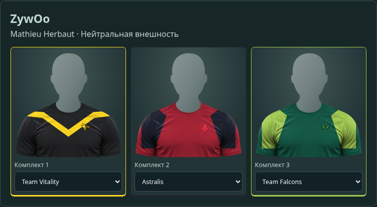

# Эмблемы и портреты в базе R3.2

Готовый личный пакет содержит 338 студийных портретов реальных игроков. [Состав, источники и установка](PRIVATE_STUDIO_R32.md). [Комплекты 287 команд и связи организаций](CLUBS_AND_KITS_R32.md).

Поставка от 25 ноября 2026 года включает графику для каждой из 287 команд и 36 организаций. Эмблемы находятся на диске, входят в Windows ZIP и переносятся вместе с экспортированным пакетом. Для матчей и редактора подключение к сайтам клубов не требуется.

| Что посчитано | Всего | Оригинальная эмблема | Игровая эмблема |
|---|---:|---:|---:|
| Команды | 287 | 27 | 260 |
| Организации | 36 | 17 | 19 |
| Записи с эмблемой | 323 | 44 | 279 |
| Разные изображения в поставке | 283 | 22 | 261 |

В личной библиотеке оригиналы доступны для 194 команд и 34 организаций. [Установка, основания и список оставшихся 93 команд](PERSONAL_BADGES_R32.md).

Одноимённые организация и команда используют общий файл. BIG Academy, BIG EQUIPA, HEROIC Academy, MOUZ NXT и paiN Academy также используют подтверждённый знак своей основной команды. При сверке 290 исходных названий три пары обозначали один и тот же состав на одну дату. В новом пакете остались Team Nemesis, 5star eSports и SINNERS Esports. Старые названия перечислены в реестре. [Все клубы, происхождение и источники](CLUB_BADGE_SOURCES.md) · [Команды с игровой эмблемой](CLUB_BADGE_SOURCES.md#команды-с-игровыми-эмблемами) · [Организации](CLUB_BADGE_SOURCES.md#организации)

| Тир в игре | Команды | Оригинальная | Игровая |
|---|---:|---:|---:|
| 1 | 16 | 5 | 11 |
| 2 | 48 | 12 | 36 |
| 3 | 223 | 10 | 213 |

## Как проверялись оригиналы

По каждому исходному названию искали клубную страницу, варианты написания, эмблему и условия использования. Для коротких названий в запрос добавляли игрока, когда он был известен. Отдельный проход охватил социальные сети, FACEIT и турнирных операторов. Сравнивали результаты с профилями HLTV и Liquipedia, карточками отдельных файлов Commons и закреплёнными каталогами изображений. В реестре сохранены конкретные найденные страницы. Ссылка на карточку команды подтверждает её идентичность. Для поставки оригинала дополнительно проверяли конкретную версию знака и условия использования. [Каталог CS и CS:GO](https://github.com/lootmarket/esport-team-logos/tree/6dcc356a2100385517101e11a07f8a5a0d5dbe9e) · [Каталог Teams](https://github.com/phantzzy/NoScope-Assets/tree/e023cb78488e35bdd6fe227de91a7dace7b073b0/Teams) · [Реестр официальных публикаций клубов](https://github.com/Aut-sep/Astrbot-plugin-CS2-match-push/blob/77f36c61cacd85ff08cb2f08bc2260046e7d6b64/docs/team-logos.md)

Для простых знаков зафиксирована карточка с основанием PD-textlogo и копия рисунка. Для версий MIBR Academy и NAVI Junior отдельно отмечена текстовая подпись академии. Условия G2 Esports распространяются на фирменную графику в медиа, 3DMAX публикует прозрачный знак для использования фанатами, партнёрами и прессой. У Team Spirit белая эмблема отображается на чёрной подложке. На миниатюре формы вышивка появляется, когда сам знак достигает требуемых 18 пикселей. Названия и знаки принадлежат соответствующим клубам. [G2 Esports](https://g2esports.com/pages/brand-guidelines) · [3DMAX](https://3dmax.gg/kits-medias/) · [Team Spirit](https://teamspirit.gg/press-kit_EN.pdf)

У Team Vitality найден оригинал и прямое требование письменного разрешения на воспроизведение. У GamerLegion отметка CC BY размещена над копией со стороннего сайта с неизвестным автором. В таких случаях в поставку включена игровая иллюстрация с причиной решения в карточке. [Условия Team Vitality](https://vitality.gg/en-eu/pages/general-conditions-of-use-1) · [Карточка файла GamerLegion](https://commons.wikimedia.org/wiki/File:GamerLegion_Logo.webp)

Для каждого резервного рисунка отдельно выбирали сюжет, силуэт и композицию. Игровые иллюстрации созданы для EsportSim с помощью генератора изображений. Графика подготовлена как прозрачные PNG 192 × 192 с пропорциональным масштабированием. SHA-256 в имени файла и каталоге позволяет проверить поставку. В базе происхождение оригинала помечено как подтверждённое, игровой эмблемы — как моделируемое. [Локальный каталог и журнал проверки по клубам](../backend/data/club-art/catalog.json)

## Портреты и экраны игры

**Готовых студийных портретов реальных игроков в поставке — 0.** Для этих кадров одновременно нужны подходящий ракурс и качество, подтверждение личности и права на отделение головы и распространение результата. Такого исходника для включения в эту поставку подтвердить не удалось. Ранее отклонённые снимки внесены в список исключений импортера. У трёх сотрудников сохранены ссылки на исходные фотографии. [Система обработки портретов](PORTRAITS_R32.md)

На снимках открыт настоящий игровой профиль ZywOo. Сравнение в примерочной оставляет его нейтральную внешность и показывает комплекты Team Vitality, Astralis и Team Falcons. Примерка не записывает трансфер в историю. [Профиль ZywOo на ПК](screenshots/r32-zywoo-profile.png) · [Примерочная на смартфоне](screenshots/r32-zywoo-three-kits-phone.png)

| Профиль команды | Экран |
|---|---|
| Acend, тир 3, оригинальный клубный знак | [Профиль на ПК](screenshots/r32-acend-profile.png) |
| Team Vitality, игровая эмблема, переходы к организации и игрокам | [Профиль на планшете](screenshots/r32-vitality-profile-tablet.png) |
